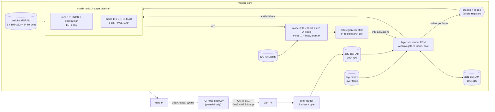

# mpnpu — switchable 1-bit / 8-bit NPU for the Tang Nano 9K

A small open-source neural-network accelerator for the **Sipeed Tang Nano 9K** (Gowin GW1NR-9: 8,640 LUT4,
20 18x18 multipliers, 468 Kbit BSRAM). Its matrix unit switches **per layer** between a 64-lane XNOR+popcount
datapath (1-bit weights, LUTs only) and an 8-lane INT8 MAC datapath (DSP blocks), selected by a single
`precision_mode` register that the sequencer loads from a layer table generated from a config file.

It runs MNIST end to end as a USB-UART accelerator: the PC sends a packed 28x28 image, the FPGA runs
the whole network (1-bit conv, 1-bit conv, INT8 dense) and returns the digit. No GPU or ML framework is
involved on the PC.

It is **inspired by and designed to plug into** [Google's Coral NPU](https://github.com/google-coral/coralnpu)
(Apache-2.0), but it does not synthesize a Coral core: see [Relationship to Coral NPU](#relationship-to-coral-npu).

## What is verified, and what is not

| Claim | Status | How |
|---|---|---|
| Matrix unit is correct in both modes, incl. mode switching | **Verified (simulation)** | `tb/tb_matrix_unit.sv`: 522 randomized dot products + corner values |
| Full inference is bit-exact vs a Python golden model | **Verified (simulation)**: 300 test images, 0 mismatches (log: `docs/sim_top_300.log`) | `tb/tb_top.sv`: real UART protocol; checks class, all 256 intermediate counts, winning logit per image. `make sim-top` runs 64 images; 300 via `-Ptb_top.NV=300` after `train_export.py --skip-train --n-vectors 300` |
| MNIST accuracy | **Measured**: 96.65% on the full 10,000-image test set | integer golden model (`sw/golden.py`), agrees with the float model on 99.99% of images |
| Compute latency | **Measured in simulation**: 43,934 cycles = **1.63 ms @ 27 MHz** | cycle counter in the core |
| End-to-end latency < 20 ms | **Computed**, not measured on hardware: ~10.6 ms @ 115200 baud, ~2.7 ms @ 1 Mbaud | arithmetic on the protocol (99 bytes up, 4 back) + measured compute |
| Weight storage reduction ≥ 60% | **Met**: 68.7% (packed) / 64.6% (as stored) smaller than all-INT8 | `docs/model_report.json` |
| Fits the GW1NR-9 | **Synthesis estimate only** (Yosys): see [Resources](#resources) | no Gowin EDA place-and-route was possible here |
| Timing at 27 MHz for the full design | **Not verified** | only the matrix unit alone was timed (51 MHz) |
| Runs on a real board / power < 0.5 W | **Not tested / not measured** | no hardware or Gowin power analyzer available |
| On-device learning | **Not implemented** | see [Limitations](#limitations-and-roadmap) |

## Architecture



### The network

```
28x28 binary image (bit=1 -> +1)
  conv3x3  1 -> 16   1-bit weights  -> BN+sign folded into a threshold -> maxpool2   13x13x16   [mode 0]
  conv3x3 16 -> 64   1-bit weights  -> threshold                       -> maxpool2    5x5x64    [mode 0]
  per-channel counts of +1 in four overlapping 3x3 regions of the 5x5 map (0..9) -> 256 int8    [mode 0 -> 1]
  dense   256 -> 10  8-bit weights  -> +bias -> argmax                                          [mode 1]
```

Binary max-pool is a logical OR, and BN+sign collapses to one integer threshold per channel on the
XNOR match count (a negative BN scale is handled by inverting that channel's weight bits). Both folds are
exact; the integer model and the float model agree on 99.99% of the test images (differences are float
rounding at exact ties).

A first version used one global count per channel (64 inputs to the dense layer) and plateaued at 88.7%
test accuracy. Counting over four overlapping regions keeps coarse spatial layout and reached 96.65% for
2.5 KB of extra INT8 weights, which is why the dense layer has 256 inputs.

### The matrix unit (`rtl/matrix_unit.sv`)

One beat per cycle: a 64-bit activation word and a 64-bit weight word. A dot product of any length is a run of
beats; `in_first` clears the accumulator and `in_last` raises `out_valid` with the result (latency 3 cycles).

| `precision_mode` | Lanes per beat | Datapath | Result |
|---|---|---|---|
| 0 | 64 x 1-bit | `popcount(~(a ^ w))`, LUTs only | number of matching lanes; the signed +-1 dot is `2*matches - K`, which the consumer folds into its threshold |
| 1 | 8 x int8 | 8 signed 8x8 multipliers + adder tree (maps to 8 `MULT9X9`) | signed sum of products |

The inactive datapath's inputs are forced to zero so it does not toggle. The mode may only change while the
pipeline is empty; the sequencer guarantees that by waiting for the last result of a layer before it loads the
next descriptor.

### Layer table (the "config file")

`sw/model_config.json` lists the layers and their precision. `sw/train_export.py` reads it and emits
`rtl/mem/layers.hex`, one 64-bit descriptor per layer:

```
[0] mode   [1] src_sel   [2] pix16   [3] sink_cnt   [8:4] in_w   [12:9] pout_w   [16:13] pout_h
[23:17] out_c   [29:24] nchunk   [39:30] wbase   [47:40] tbase   [48] last
```

At each layer the sequencer writes `precision_mode <= descriptor.mode`, so changing a layer's precision is a
config edit plus re-export. The sequencer currently implements two layer kinds, `conv3x3_pool2` (1-bit) and
`dense` (8-bit); the exporter rejects other combinations (for example an 8-bit conv) with a clear error.
Weights, thresholds and the layer table are baked into the bitstream through `$readmemh`; there is no runtime
model loader.

### Memory and the BRAM saving

1-bit weights are packed 32 per 32-bit word; INT8 weights are packed 4 per word. A weight beat is read as two
32-bit BSRAM banks in parallel.

| | all INT8 | mixed (this design) |
|---|---|---|
| conv1 16x9 | 144 B | 18 B |
| conv2 64x144 | 9,216 B | 1,152 B |
| dense 256x10 | 2,560 B | 2,560 B |
| **total, packed** | **11,920 B** | **3,730 B (-68.7%)** |
| **total, as stored** (conv2 rows padded 144 -> 192 bits to align to 64-bit beats) | | **4,224 B (-64.6%)** |

Plus 80 B of thresholds and 40 B of biases. The model is ~4.3 KB, far below the 58.5 KB that 468 Kbit of BSRAM
provides. Note that 468K is **bits**: the board has 26 BSRAM blocks of 18 Kbit, about 58.5 KB, not 468 KB.
At this model size the saving is in bits only; the design still occupies 6 BSRAM blocks (4 weights, 2
activation buffers) because blocks are allocated whole.

## Resources

From `make synth` (Yosys 0.71 `synth_gowin`, not Gowin EDA, so treat as an estimate):

| Resource | Used | Available |
|---|---|---|
| LUT4 cells + ALU (carry) cells | 4,555 + 1,421 = ~5,976 (≈69%, an upper bound: LUT1/ALU can share slices) | 8,640 |
| Flip-flops | 1,988 | 6,480 |
| DSP `MULT9X9` | 8 | 20 18x18 (40 9x9) |
| BSRAM | 6 (4 `SPX9`, 2 `DPX9B`) | 26 |

**The design needs the DSP blocks to fit.** Built from LUTs (`make synth-nodsp`) the same design needs about
9,400 cells, which is more than the device has.

Timing: the matrix unit alone, with its multipliers in LUTs, places and routes at **51 MHz** with nextpnr-gowin
(it was 27.6 MHz before the middle pipeline register was added). The full design could not be placed with the
open-source tools used here: this nextpnr-gowin build cannot place `MULT9X9` or `SPX9` on GW1N-9C. A real
27 MHz timing report needs Gowin EDA.

## Performance and the comparison with the Coral USB Accelerator

| | This design (Tang Nano 9K @ 27 MHz) | Coral USB Accelerator |
|---|---|---|
| Peak compute | 3.46 GOPS 1-bit, 0.43 GOPS INT8 (counting 1 MAC = 2 ops) | 4 TOPS INT8 (datasheet) |
| Effective on this MNIST net | 1.26 GOPS: 1.02 M MACs in 1.63 ms | not benchmarked here |
| Precision | 1-bit and INT8, switchable per layer | INT8 only |
| Power | **not measured** (target < 0.5 W) | ~2 W at peak (2 TOPS/W, datasheet) |
| Interface | UART over the on-board USB bridge | USB 3.0 |
| Design | open RTL, re-synthesizable | closed ASIC |

This design is about 1,000x (1-bit) to 9,000x (INT8) slower than the Edge TPU at peak. It is not a competitor on
throughput, and the "advantage" is something else: open, modifiable hardware, a precision choice that is visible
and controllable per layer, and a ~$15 board. Conv layer 1 uses only 9 of the 64 binary lanes and conv layer 2
uses 144 of 192, so there is also headroom in how well the unit is used.

Latency budget for one image (`make sim-top` measures the first row, the others are arithmetic):

| UART baud | upload (99 B) | compute | reply (4 B) | total |
|---|---|---|---|---|
| 115,200 (default) | 8.59 ms | 1.63 ms | 0.35 ms | ~10.6 ms |
| 1,000,000 | 0.99 ms | 1.63 ms | 0.04 ms | ~2.7 ms |

The default `CPB` in `rtl/mpnpu_top.sv` is 234 (115,200 baud at 27 MHz). Higher rates depend on what the
on-board USB-UART bridge accepts; set `CPB = 27` for 1 Mbaud and pass `--baud` to the host script. This was
not tried on hardware.

## Quick start

```bash
pip install torch brevitas numpy pyserial          # training + host
apt install iverilog verilator                      # or any SystemVerilog simulator
pip install yowasp-yosys                            # optional: resource estimate

make train        # ~8 min on 2 CPU cores: trains, folds BN, writes rtl/mem/*.hex and tb/vectors/*.hex
make test         # unit test + MMIO test + full UART-level inference vs golden model
make synth        # Yosys resource estimate for the Tang Nano 9K
```

The MNIST idx files go in `data/` (`train-images-idx3-ubyte.gz`, etc.).

**On the board:** open `gowin/` (see `gowin/README.md`), build and program, then

```bash
python3 sw/host_client.py --port /dev/ttyUSB1 --probe
python3 sw/host_client.py --port /dev/ttyUSB1 --mnist data/t10k-images-idx3-ubyte.gz \
                          --labels data/t10k-labels-idx1-ubyte.gz -n 200
```

Protocol: `0xA5` + 98 bytes (pixel *i* is bit *i*%8 of byte *i*/8, row-major, threshold 128) returns
`0x5A, class, cycles_lo, cycles_hi`; `0xA4` returns `NPU1`. LEDs (active low): busy, `precision_mode`, done,
class[2:0].

## Repository layout

```
rtl/matrix_unit.sv      switchable 1-bit / INT8 matrix unit (the core of the project)
rtl/mpnpu_core.sv       layer sequencer, window gather, pooling, counters, argmax
rtl/mem.sv              BSRAM-style RAM / ROM
rtl/uart.sv, mpnpu_top.sv   UART protocol and Tang Nano 9K top level
rtl/mem/*.hex           generated: weights, thresholds, bias, layer table
sw/train_export.py      Brevitas training, BN folding, packing, export
sw/golden.py            bit-exact integer reference, decoded from the packed memories
sw/host_client.py       PC client
sw/model_config.json    per-layer precision config
tb/                     testbenches and generated test vectors
gowin/                  .cst, .sdc, hand-written .gprj and notes
coral_adapter/          memory-mapped wrapper + Coral SoC integration notes
docs/model_report.json  accuracy, sizes, thresholds
```

## Relationship to Coral NPU

I read the Coral NPU repository to decide how to build on it. What I found:

- `CoreMini` is a 4-wide superscalar RV32IMF core with 4 ALUs, an FPU, a retirement buffer and large
  multi-port register files, and the default TCMs (8 KB + 32 KB = 320 Kbit) would use 68% of this chip's BSRAM
  on their own. It is much larger than 8,640 LUT4s (my estimate; I did not synthesize it), and the repo's FPGA
  flow targets Lattice Nexus and Vivado, not Gowin.
- The only matrix engine is the experimental Zvt / VME unit in `hdl/verilog/rvv/design/Zvt/`, and it sits behind a
  full RVV vector backend.

So this project does **not** put a Coral core on the FPGA. It provides the matrix unit as a standalone design and
as a memory-mapped peripheral (`coral_adapter/mpnpu_mmio.sv`) that a Coral scalar core can drive over its SoC bus.
Integration points, and why the matrix unit is not a drop-in replacement for the Zvt lane, are in
[`coral_adapter/README.md`](coral_adapter/README.md). The adapter is tested in isolation only; it has not been
built into a Coral SoC.

No Coral source is copied into this repository.

## Limitations and roadmap

- **No hardware validation.** Everything above marked verified was done in simulation. Timing, power, real
  UART rates and the Gowin IDE project are untested.
- **On-device learning is not implemented.** Weights are in read-only memory initialised from the bitstream.
  A minimal version (fine-tuning the dense layer with a perceptron-style update) would need a write port on the
  weight memory, a small update FSM and a labelled-sample command in the UART protocol; the dense layer's
  int8 weights and int32 accumulators already have the right shape for it. Training the 1-bit layers on
  the device is not realistic in 58 KB.
- First-layer input is binarized (threshold 128); grayscale detail is lost, which costs accuracy against an 8-bit-input model.
- Sequencer supports only the conv-conv-dense topology; more general graphs need a richer descriptor and FSM.
- Conv layer 1 wastes most of the 64 binary lanes; packing several windows per beat would raise utilisation.

## License

Apache License 2.0, see [`LICENSE`](LICENSE).
